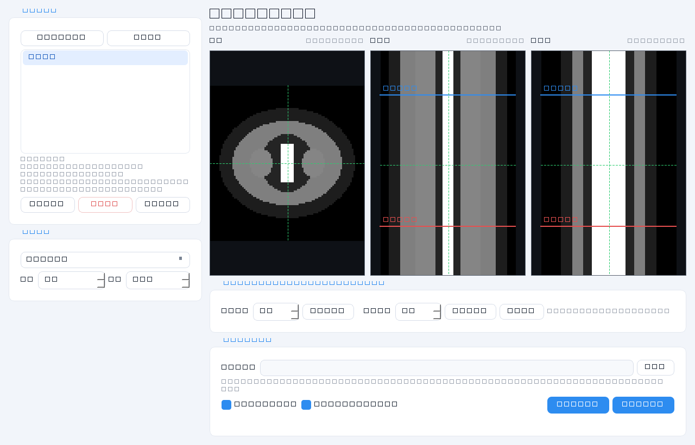
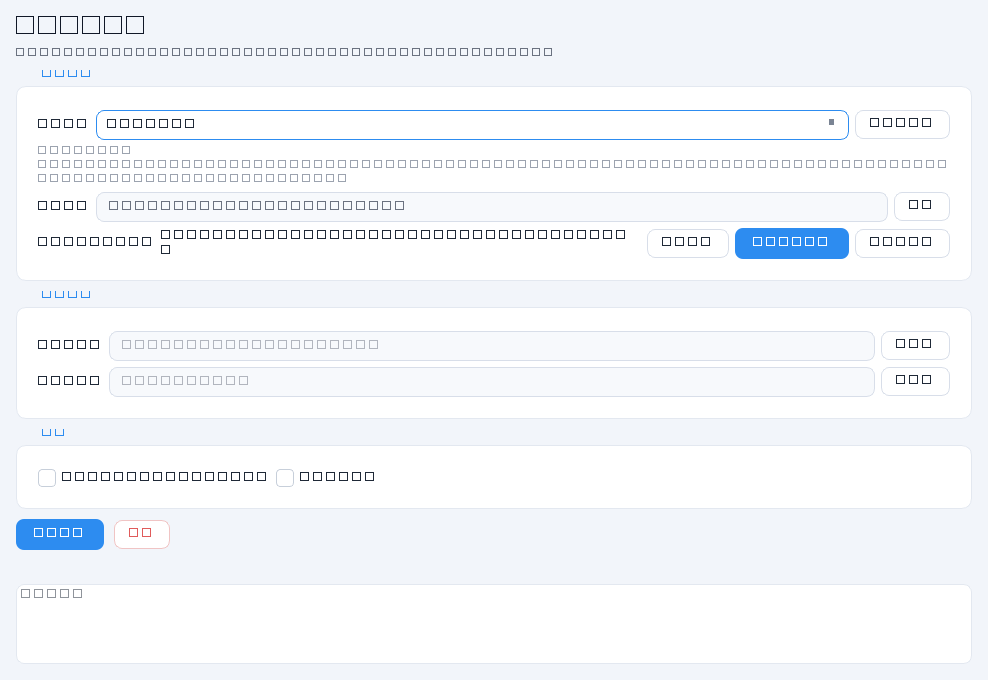
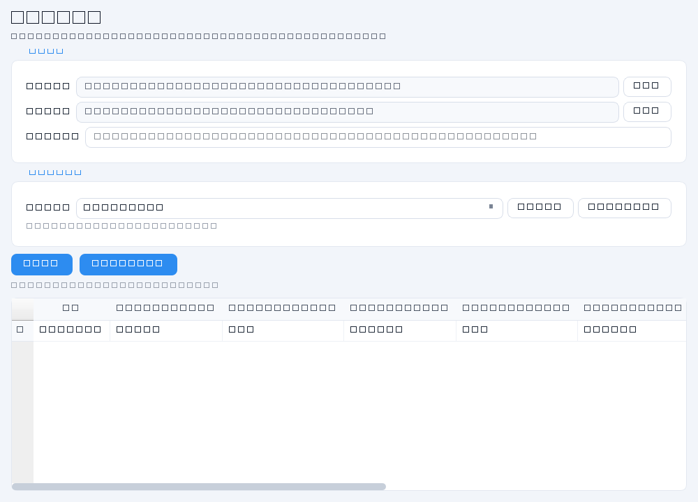

# CT 身体成分分析系统（Abdominal CT Body Composition Analysis）

一套面向临床与科研的**腹部 CT 身体成分自动分割与统计软件**：无需编程、无需安装 Python 与 nnUNet，解压即用。软件基于 nnU-Net V2 深度学习模型，可对腹部 CT 自动分割**皮下脂肪、内脏脂肪、骨骼肌、肌间脂肪**（及腰大肌、腹直肌、腰方肌、竖脊肌等肌群）区域，并自动计算每个区域的**体积与平均 CT 值**，一键导出 Excel 数据，供临床与科研使用。

---

## 功能亮点

- **三个流程，简单清晰**：
  1. **① 图像转换与定位**：把 PACS 导出的 DICOM 转成 NRRD，并在轴位/冠状位/矢状位三视图上浏览、选择导出层面范围（例如腹部：隔顶至耻骨联合下缘）；
  2. **② 自动分割**：一键批量分割所有病例，内置 4 个 nnU-Net 模型（身体成分 2D/3D、肌肉群 2D/3D）；
  3. **③ 数据计算**：自动计算各分割区域的体积与平均 CT 值，按区域导出 Excel。
- **开箱即用**：模型已内置；分割所需计算环境首次使用时自动安装（有 NVIDIA 显卡自动用 GPU 加速）。
- **界面友好**：面向非计算机专业人员，中文界面，全程有进度提示。

| 主菜单 | 图像转换与定位 | 自动分割 | 数据计算 |
|---|---|---|---|
|  |  |  |  |

---

## 系统要求

- Windows 10 / 11（64 位）
- 建议 8GB 及以上内存
- 有 NVIDIA 显卡可 GPU 加速（没有也能用，CPU 模式较慢）
- **首次使用需联网**（自动下载分割计算环境，约 0.5~2.5GB，只需一次）

---

## 快速开始（非专业用户）

1. 在 [Releases](https://github.com/LuoXiaoC-66/Abdominal-CT-Body-Composition-Analysis/releases) 下载最新便携版压缩包（如 `AutoSegment_便携版_v1.0.zip`，约 1.5GB）；
2. 解压到**可写目录**（建议桌面或文档，不要放 Program Files）；
3. 双击 `AutoSegment.exe` 启动；
4. 按 ① → ② → ③ 的流程操作即可获得身体成分数据；
5. 第一次点“开始分割”时，软件会自动联网安装分割环境（有进度提示，只需一次；若电脑已有可用的 nnUNet 环境会自动复用，不会重复安装）。

---

## 使用说明

### ① 图像转换与定位（DICOM → NRRD）

1. 点击“**添加数据文件夹**”选择病人的 DICOM 文件夹（支持多层子文件夹，自动识别；也可“批量添加”一个包含多个病人的父文件夹）；
2. 在三个视图中浏览：
   - **滚轮**：切换当前视图的层面；
   - **左键点击**：定位（三视图十字线联动）；
   - **冠状位/矢状位右键**：把该处设为起始/结束层面；
3. 设置导出层面范围（如腹部：隔顶至耻骨联合下缘；每个病人单独记忆），可调窗宽窗位（腹部软组织窗/骨窗/肺窗）；
4. 选择输出文件夹，点击“**导出当前病例**”或“**导出全部病例**”，自动保存为 `Patient_序号_0000.nrrd`（序号按导入顺序自动编号，已有文件自动接着编号）。

### ② 自动分割

1. 选择**输入文件夹**（① 转换出的 NRRD）和**输出文件夹**（预测结果）；
2. 点“**开始分割**”，软件自动检测/使用 nnUNet 环境，逐个病例预测，结果保存为同名 `.nrrd`；
3. 若需要，可在“模型管理”中添加/修改模型（模型路径存于 `models.json`）。

### ③ 数据计算

1. 选择**病例图像文件夹**和**分割结果文件夹**（若分割文件带后缀如 `_seg`，在“分割文件后缀”填写）；
2. 点“**开始计算**”，表格预览每个病例各区域的体积与平均 CT 值；
3. 点“**导出 Excel**”，得到按区域划分的工作表（体素数、体积 mm³/cm³、平均/标准差/最小/最大 CT 值），以及“汇总_体积(cm³)”“汇总_平均CT(HU)”便于统计。

---

## 内置模型

便携版内置 4 个 nnU-Net V2 模型（随压缩包分发，不包含在源码仓库中）：

| 模型 | 分割区域 |
|---|---|
| 身体成分-2D / 3D | 内脏脂肪、皮下脂肪、骨骼、骨骼肌、肌间脂肪 |
| 肌肉群-2D / 3D | 腰大肌、腹直肌、腰方肌、竖脊肌 |

源码运行的用户请将训练好的模型按 nnUNet 目录结构放入 `models/`，并在软件“模型管理”中填写路径。

---

## 开发者 / 源码运行

```bash
# 安装依赖（Python 3.10–3.13）
pip install -r requirements.txt

# 自动分割需要（建议使用训练 nnUNet 的 conda 环境）
pip install nnunetv2 torch

# 启动
python main.py
```

- 目录结构：`app/` 核心逻辑、`ui/` 界面、`tools/make_sample_dicom.py` 生成示例数据、`tests/smoke_test.py` 自测。
- 源码仓库不含模型与 nnUNet 运行环境；运行界面②时软件会自动检测或安装。

---

## 常见问题

- **提示“使用 CPU”**：正常（无 NVIDIA 显卡或驱动较旧），只是较慢；可更新 NVIDIA 驱动到 551+ 后用 GPU。
- **首次安装很慢/失败**：需要联网；可在网络稳定时重试“自动配置环境”。
- **中文乱码**：已修复为 UTF-8 输出；若日志出现乱码，请使用最新版本。
- **便携文件夹放哪里**：放在桌面/文档等可写位置，不要放 Program Files。
- **模型管理**：添加模型后路径保存在 `models.json`，为相对路径，整体移动软件文件夹仍可用。

---

## 免责声明

本软件基于深度学习模型，结果仅供**科研与辅助分析**参考；临床决策请结合影像科专业医师的判断。
